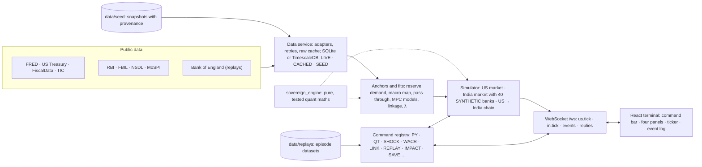

# SovereignDesk

A live, Bloomberg-style terminal that simulates the US Treasury market and the Indian money market. It is built on real data from FRED, US Treasury, TIC, RBI, FBIL, NSDL, MoSPI and the Bank of England, uses a pure-Python quant engine, and streams intraday ticks from stochastic short-rate models.

- **[DEMO.md](DEMO.md)**: a three-minute walk-through in seven beats, from a bond's price to RBI's next decision.
- **[ASSUMPTIONS.md](ASSUMPTIONS.md)**: what is real data (with its source and date) and what is modelled, fit by fit.
- **[docs/PLAN.md](docs/PLAN.md)**: the build plan and every decision taken along the way; the spec is [docs/BRIEF.md](docs/BRIEF.md).

## Quick start

Needs Python 3.12+ and Node 22.12+. On Linux/macOS use `python3` instead of `py`, or `make <task>`.

```sh
py tasks.py setup                       # .venv, editable engine + backend, npm ci, git hooks
cp backend/.env.example backend/.env    # then add your free FRED API key
py tasks.py dev                         # API on :8000 (docs at /docs), terminal on :5173
py tasks.py dev --offline               # the same from the committed seed alone, no network
py tasks.py check                       # secrets scan, lint, types, tests, build: what CI runs
py tasks.py e2e                         # Playwright smoke test in your installed Chrome
```

With Docker: `docker compose up --build` (or `make up`) starts the backend, the nginx-served frontend, TimescaleDB and Redis; open http://localhost:8080.

## The terminal


Four resizable panels, a ticker, data-quality badges (LIVE, SEED, STALE) and an event log that narrates every shock. Both markets run live on real anchors: the Treasury curve and the Fed's corridor, and India's call money market, where 40 SYNTHETIC banks trade inside RBI's corridor. Things to try:

| Command | What happens |
|---|---|
| `PY 10Y` | Price–yield: duration, convexity and how good each approximation is |
| `HIKE 25BP`, `QT 95B` | The Fed moves; EFFR, reserves, the curve and the term premium respond |
| `SHOCK JP 200B 10D LONG` | A foreign holder sells; yields, the dollar and the debt cost respond |
| `WACR`, `REPO -25BP`, `CRR 3.5`, `VRR 50000CR 7D` | India's corridor, an MPC move and RBI's operations |
| `CALL`, `LAF`, `NDTL` | Today's call market against repo (TREPS, market repo, T-bills, the clearing rounds, who borrowed and what limits trimmed); RBI's facilities and auctions; the SYNTHETIC banks' reserves and limits |
| `TAXCAL`, `CCIL` | The quarterly tax cycle: a calendar of WACR − repo, the government's tax balance at RBI against the system's surplus with RBI's likely VRRs ahead; how call money, TREPS and market repo trade and settle, with sources |
| `UST`, `DEBT`, `TIC`, `CORR` | The Treasury curve; the federal interest bill on the simulated curve; foreign holders after any sale; the Fed's corridor next to RBI's |
| `MPC` | The next MPC decision: probabilities from a Taylor rule, an ordered logit and boosted trees, trained on RBI's decisions since 2014 and backtested walk-forward from 2018 against naive baselines ([report](docs/MPC_BACKTEST.md)) |
| `SHOCK FED 50BP`, `LINK` | A Fed hike runs through to India: the US 10Y, FPI outflows, RBI's dollar sales, the rupee, rupee liquidity and WACR, each link calibrated on NSDL, RBI and FRED data; RBI can answer with VRR, OMOs, a swap or a hike |
| `IMPACT RETAIL +100BP`, `IMPACT BUSINESS IMPORTER` | What a shock means for people: an (editable, illustrative) bond portfolio repriced exactly and by duration and convexity, held against sold; a small shop and an electronics importer with EBLR and MCLR loans, imported costs and demand |
| `REPLAY GILT2022`, `REPLAY TAPER2013` | Real episodes replayed: the model driven by what actually moved, against what happened, with scores, an annotated timeline and play controls. The gilt crisis calibrates the fire-sale price impact λ |
| `GSEC`, `SPRD` | India's G-sec curve (NSS) and how a repo surprise passes through it, measured on RBI's repo changes; India's 10Y against the US 10Y |
| `TEACH`, `HELP`, `SPEED 60X` | The economics behind each panel, every function, faster time |
| `LAYOUT SAVE RATES`, `LAYOUT RATES` | Keep the four panels and their split in this browser, and bring them back; the terminal reopens as it was left |
| `SAVE TAPER`, `LOAD TAPER` | Save this run (its seed and every command that changed the markets, with when) and replay it exactly |
| `EXPORT CSV`, `EXPORT PNG` | The focused panel's main table as CSV, or its charts as one PNG |


`/` focuses the command bar and Esc comes back to it; Alt+1..4 or Alt+arrows move between panels, Alt+Enter shows one alone, F1 explains it and Alt+T toggles teach mode.

## How it fits together



Every source has a fallback: live data, then the last good raw response, then the committed seed. The quality badges say which one a panel is on, and a STALE badge flags inputs whose own date is old. The simulator's paths depend on simulated time only, so a saved run replays exactly.

## Checks

| Command | What it runs |
|---|---|
| `py tasks.py check` | Secrets scan, ruff, mypy (strict), eslint, tsc, the OpenAPI types' drift, pytest (engine and backend), vitest and the production build: CI's main job, on Python 3.12 and 3.14 |
| `py tasks.py demo` | Boots the app offline on the seed and walks the demo over the WebSocket: every beat must answer and narrate, the corridors must hold on every tick, and every command DEMO.md types must work |
| `py tasks.py e2e` | Playwright smoke test in the installed Chrome: every function's panel on the seed, the keys, layouts, a saved scenario loaded again, and CSV and PNG exports, with no console errors |
| `py tasks.py screenshots` | Re-captures [docs/screenshots](docs/screenshots) in headless Chrome |

CI also builds and probes the Docker stack and runs gitleaks.

## Layout

| Path | Contents |
|---|---|
| `engine/` | `sovereign_engine`: pure, typed quant maths with no I/O; every formula is documented and tested |
| `backend/` | FastAPI app: REST under `/api`, WebSocket at `/ws`, data adapters, simulator |
| `frontend/` | React + TypeScript terminal (Vite, Tailwind, Zustand); REST types generated from OpenAPI |
| `data/` | Real-data seed snapshots and versioned replay datasets |
| `scripts/` | Seed and replay builders, the demo check, the MPC report, the screenshots |
| `docs/` | The brief, the plan, the MPC backtest report, screenshots |
| `tasks.py` | Stdlib-only task runner; the Makefile and CI delegate to it |

## Third-party notices

The charts use [TradingView Lightweight Charts™](https://www.tradingview.com/lightweight-charts/) (Copyright TradingView, Inc., https://www.tradingview.com/; Apache-2.0) and [Apache ECharts](https://echarts.apache.org/) (Apache-2.0).
