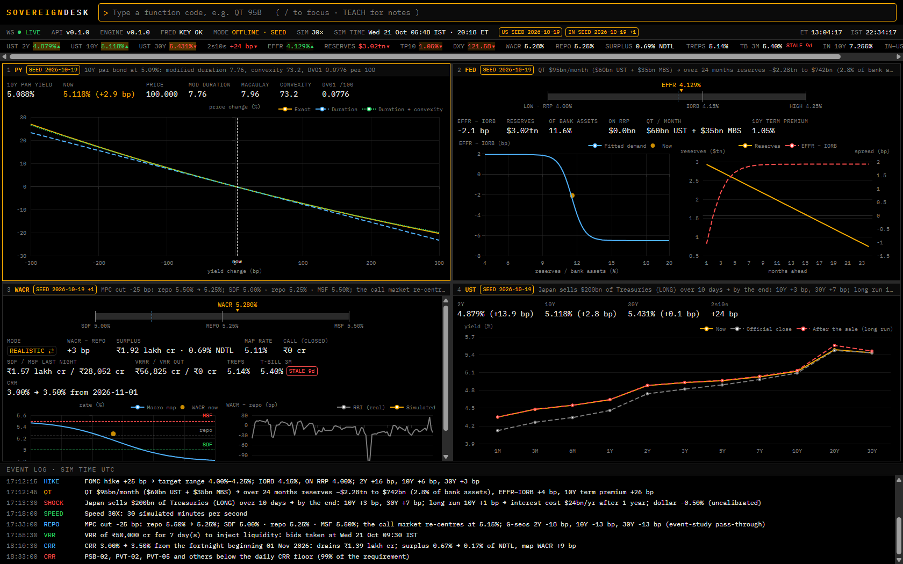
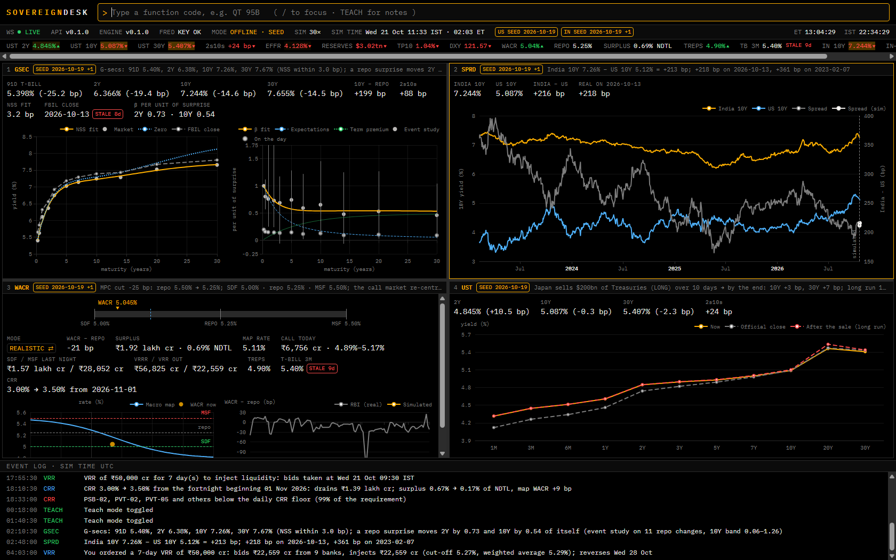

# SovereignDesk

A live, Bloomberg-style terminal that simulates the US Treasury market and the Indian money market. It is built on real data from FRED, US Treasury, TIC, RBI and FBIL, uses a pure-Python quant engine, and streams intraday ticks from stochastic short-rate models.

> Work in progress. The build plan is in [docs/PLAN.md](docs/PLAN.md) and the spec in [docs/BRIEF.md](docs/BRIEF.md).

## Quick start

Needs Python 3.12+ and Node 22.12+. On Linux/macOS use `python3` instead of `py`, or `make <task>`.

```sh
py tasks.py setup                       # .venv, editable engine + backend, npm ci, git hooks
cp backend/.env.example backend/.env    # then add your free FRED API key
py tasks.py dev                         # API on :8000 (docs at /docs), terminal on :5173
py tasks.py check                       # secrets scan, lint, types, tests, build: what CI runs
```

With Docker: `docker compose up --build` (or `make up`) starts the backend, the nginx-served frontend, TimescaleDB and Redis; open http://localhost:8080.

## The terminal



Four resizable panels, a ticker, data-quality badges (LIVE, SEED, STALE) and an event log that narrates every shock. Both markets run live on real anchors: the Treasury curve and the Fed's corridor, and India's call money market, where 40 SYNTHETIC banks trade inside RBI's corridor. Things to try:

| Command | What happens |
|---|---|
| `PY 10Y` | Price–yield: duration, convexity and how good each approximation is |
| `HIKE 25BP`, `QT 95B` | The Fed moves; EFFR, reserves, the curve and the term premium respond |
| `SHOCK JP 200B 10D LONG` | A foreign holder sells; yields, the dollar and the debt cost respond |
| `WACR`, `REPO -25BP`, `CRR 3.5`, `VRR 50000CR 7D` | India's corridor, an MPC move and RBI's operations |
| `MPC` | The next MPC decision: probabilities from a Taylor rule, an ordered logit and boosted trees, trained on RBI's decisions since 2014 and backtested walk-forward from 2018 against naive baselines ([report](docs/MPC_BACKTEST.md)) |
| `GSEC`, `SPRD` | India's G-sec curve (NSS) and how a repo surprise passes through it, measured on RBI's repo changes; India's 10Y against the US 10Y |
| `TEACH`, `HELP`, `SPEED 60X` | The economics behind each panel, every function, faster time |



`/` focuses the command bar and Alt+1..4 a panel. `py tasks.py demo` walks this demo end to end on the real seed, and `py tasks.py screenshots` re-captures [docs/screenshots](docs/screenshots). What is real data and what is modelled is listed in [ASSUMPTIONS.md](ASSUMPTIONS.md).

## Layout

| Path | Contents |
|---|---|
| `engine/` | `sovereign_engine`: pure, typed quant maths with no I/O; every formula is documented and tested |
| `backend/` | FastAPI app: REST under `/api`, WebSocket at `/ws`, data adapters, simulator |
| `frontend/` | React + TypeScript terminal (Vite, Tailwind, Zustand); REST types generated from OpenAPI |
| `data/` | Real-data seed snapshots and versioned replay datasets |
| `tasks.py` | Stdlib-only task runner; the Makefile and CI delegate to it |
