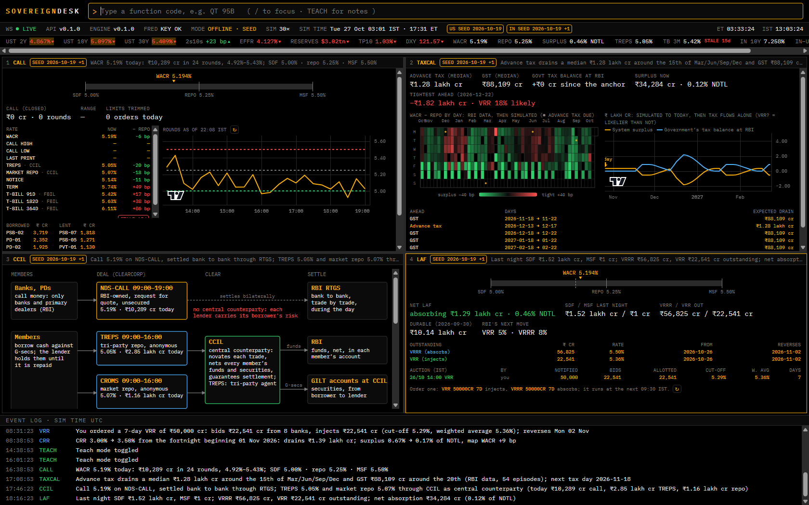
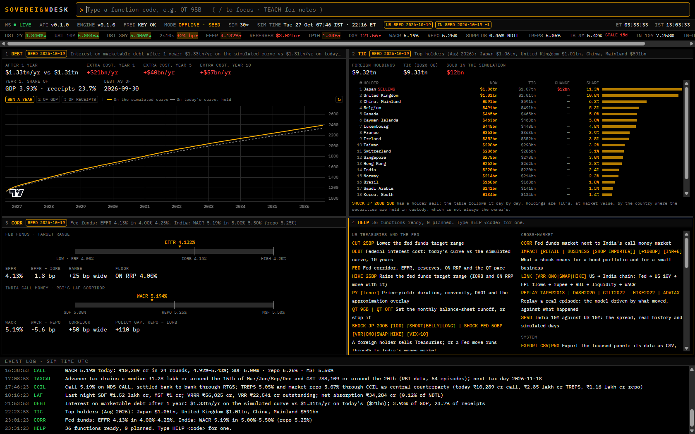
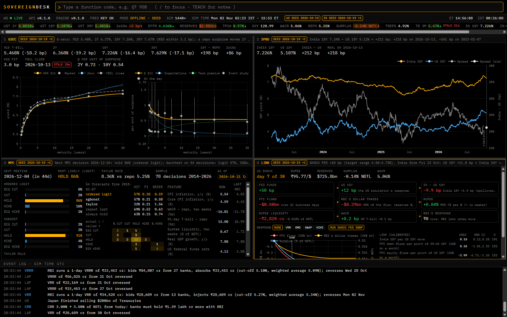
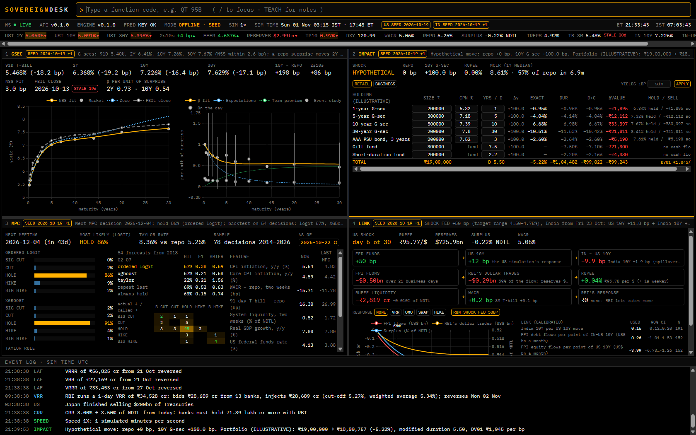
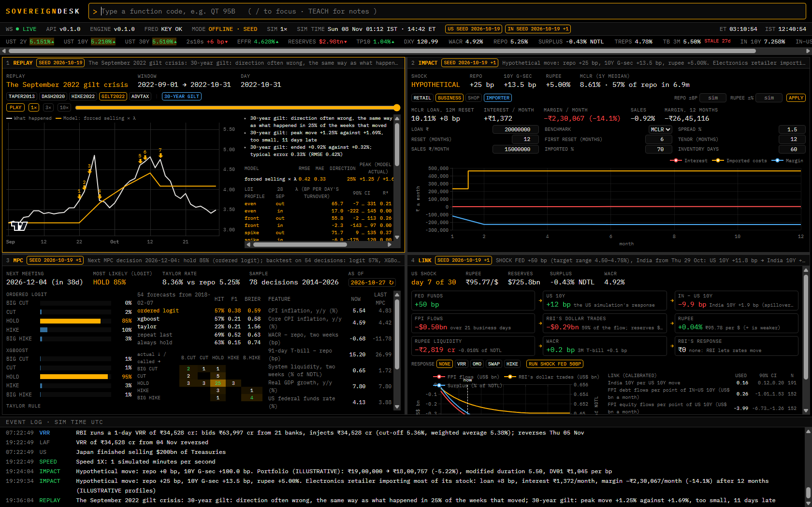
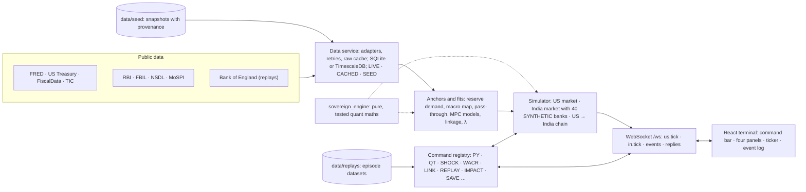

# SovereignDesk

[](https://github.com/adityashukla2615/sovereigndesk/actions/workflows/ci.yml)
[](https://adityashukla2615.github.io/sovereigndesk/)

A live, Bloomberg-style terminal that simulates the **US Treasury market** and **India's money market**, each anchored to real data, and shows how a shock in one reaches the other.

**[Open the live terminal →](https://sovereigndesk.onrender.com/)**  ·  **[Open the web demo →](https://adityashukla2615.github.io/sovereigndesk/)**

- **Live terminal**: the real simulator on Render's free plan, computing everything as you type on the committed data (no API key needed). It sleeps after 15 idle minutes, so the first visit after that takes a minute or two to wake it. Everyone connected shares one market: a shock you send moves it for all, and `RESET` puts it back.
- **Web demo**: runs entirely in your browser and is always up. Every reply and price tick in it was recorded from the real simulator on the committed data, and is played back.

To run your own copy, clone the repo and start it (two commands, below), or deploy it to Render free:

[](https://render.com/deploy?repo=https://github.com/adityashukla2615/sovereigndesk)


## What it shows

The terminal tells one economic story, from a single bond to a central bank's next decision:

1. **Price and yield.** Why a bond's price falls as yields rise, and how duration and convexity approximate it.
2. **The Fed and its balance sheet.** The fed funds corridor, reserves, and what quantitative tightening (QT) does to them, to the curve and to the term premium.
3. **A foreign holder sells.** Japan, China or the UK sells Treasuries; yields rise, part of the move stays, and the US interest bill grows.
4. **From the Fed to India.** A Fed hike moves the US 10-year, foreign money leaves India, RBI sells dollars, the rupee and rupee liquidity move, and India's call rate responds.
5. **India's money market.** 40 synthetic banks trade call money inside RBI's corridor every quarter hour, with RBI's auctions, reserve rules and the quarterly advance-tax squeeze.
6. **History.** Five real episodes (the 2013 taper tantrum, the 2020 dash for cash, the 2022 gilt crisis, the 2022–23 hiking cycle, and advance-tax squeezes) replayed against what actually happened.
7. **What comes next.** A forecast of RBI's next policy decision, backtested honestly against naive baselines.

Every number is either real data, shown with its source and date, or the output of a model that is documented in [ASSUMPTIONS.md](ASSUMPTIONS.md). The banks are labelled SYNTHETIC, and the example portfolios ILLUSTRATIVE.

## Quick start

Needs Python 3.12+ and Node 22.12+. On Linux or macOS use `python3` instead of `py`, or `make <task>`.

```sh
git clone https://github.com/adityashukla2615/sovereigndesk.git
cd sovereigndesk
py tasks.py setup                       # .venv, the engine and backend, npm packages, git hooks
py tasks.py dev --offline               # from the committed data alone: no key, no network
```

Open **http://localhost:5173**. Keep that window running while you use the terminal; Ctrl+C stops it.

For live data, get a free [FRED API key](https://fred.stlouisfed.org/docs/api/api_key.html), copy `backend/.env.example` to `backend/.env`, put the key in it, and run `py tasks.py dev`. The key stays in `backend/.env`, which git ignores. It is never committed, logged or shown.

With Docker, either:

- `docker compose up --build` (or `make up`) starts the backend, the nginx-served terminal, TimescaleDB and Redis. Then open http://localhost:8080.
- `docker build -t sovereigndesk . && docker run -p 10000:10000 sovereigndesk` runs everything in one container on the committed data. Then open http://localhost:10000. This is the image `render.yaml` deploys.

[DEMO.md](DEMO.md) is a three-minute walk-through in seven beats, with what to type and what to say.

## Using the terminal

- **Command bar** (top). Type a function code, then its arguments, then Enter: for example `QT 95B` or `SHOCK FED 50BP`. Upper or lower case both work. Suggestions appear as you type: arrow keys pick one, Tab completes it, and with an empty bar the arrows walk your history. `/` jumps to the bar from anywhere; don't type it into the command itself.
- **Four panels.** Each function opens in the focused panel (amber border), or refreshes the panel already showing it. Drag the borders to resize.
- **Ticker and status strip.** These show live prices that blink as they move, the simulated time in Mumbai and New York, and data-quality badges:
  - **LIVE**: fetched within 36 hours.
  - **CACHED**: an older fetch, or the source is down.
  - **SEED**: the committed snapshot.
  - **STALE**: an input whose own date is old.
- **Event log** (bottom). Every shock and policy move is narrated with its computed numbers. For example: "Japan sells $200bn … 10Y +3 bp … interest cost +$0.4bn/yr".

| Key | Does |
|---|---|
| `/` | Focus the command bar (Esc from a panel does too) |
| Alt+1 … Alt+4 | Focus panel 1–4; the next function opens there |
| Alt+← → ↑ ↓ | Move to the neighbouring panel |
| Alt+Enter | Show the focused panel full screen, and back |
| F1 | Explain the focused panel's function |
| Alt+T | Teach mode: every panel explains its own economics |

## Features and commands

`HELP` lists every function; `HELP SHOCK` explains one.

### US Treasuries and the Fed

| Command | What it does |
|---|---|
| `PY 10Y` (or `2Y`, `5Y`, `30Y`) | Price–yield curve of a par Treasury: modified duration, convexity and DV01. Plots the exact price change against the duration-only and duration + convexity approximations |
| `UST` | The live Treasury par curve against today's official close |
| `FED` | The fed funds target range, IORB, ON RRP and EFFR; reserves against a reserve-demand curve fitted on weekly data since 2017 |
| `HIKE 25BP`, `CUT 50BP` | Move the target range. IORB and ON RRP move with it; the curve reprices, most at the front end |
| `QT 95B`, `QT OFF` | Set the monthly balance-sheet runoff. Projects reserves, EFFR − IORB and the 10-year term premium over 24 months |
| `SHOCK JP 200B 10D LONG` | A foreign holder sells: country code (JP, CN, UK…), amount, pace in days, and where on the curve (SHORT, BELLY, LONG). Shows a temporary and a permanent price impact, then the interest bill |
| `DEBT` | The federal interest bill over ten years, on today's curve against the simulated one, in dollars, % of GDP or % of receipts |
| `TIC` | Major foreign holders from Treasury's TIC data, with live holdings after any sale |

### India's money market

| Command | What it does |
|---|---|
| `WACR` | The weighted average call rate in RBI's corridor (SDF floor, repo, MSF ceiling), on a macro map fitted to RBI's daily releases since April 2022, with real and simulated history |
| `WACR POLICY`, `WACR REALISTIC` | Keep call rates inside the corridor, or let them stray as often as RBI's data shows they do (the default) |
| `CALL` | Today's call market, round by round (09:15–19:00 IST). Shows WACR, the high and low, the CCIL segments (TREPS, market repo) and the T-bills against repo; who borrowed and lent; and orders that participation limits trimmed |
| `LAF` | RBI's liquidity facilities: last night's SDF and MSF, VRR and VRRR outstanding, the auctions run, and how likely RBI's fitted reaction makes the next one |
| `REPO +25BP`, `CRR 3.5` | An MPC move (the corridor and the G-sec curve move at once), or a cash reserve ratio change from the next fortnight, with the liquidity it drains |
| `VRR 50000CR 7D`, `VRRR 50000CR 7D` | Order an RBI auction to inject or absorb liquidity. It runs at 09:30 IST with the banks bidding their own gaps |
| `NDTL` | The 40 SYNTHETIC banks: NDTL, the CRR they must hold, their balances, SLR securities, MSF capacity and borrowing limits |
| `TAXCAL` | The quarterly liquidity cycle. A calendar of WACR − repo by day, and the government's tax balance at RBI against the system's surplus, simulated and then projected. Marks the days RBI's VRRs become likely |
| `CCIL` | How call money trades on NDS-CALL and settles bank to bank, and how TREPS and market repo settle through CCIL as central counterparty. Every claim is cited |
| `GSEC` | India's G-sec curve (Nelson–Siegel–Svensson on FBIL's par yields), and how a repo surprise passes through it, measured on RBI's repo changes |
| `SPRD` | India's 10-year against the US 10-year: real history and simulated days |
| `MPC` | The next MPC decision as probabilities from a Taylor rule, an ordered logit and boosted trees, with a walk-forward backtest since 2018 against "repeat the last decision" and "always hold" ([report](docs/MPC_BACKTEST.md)) |

### Across the two markets

| Command | What it does |
|---|---|
| `SHOCK FED 50BP` | The Fed moves and the chain runs into India: US 10Y → India 10Y → foreign portfolio flows → RBI's dollar sales → rupee → liquidity → WACR. Each link is calibrated on public data. Add `VRR`, `OMO`, `SWAP` or `HIKE` to choose RBI's answer, and `VIX+10` for a risk-off shock |
| `LINK` | The chain node by node, with each link's estimate and 90% interval; `LINK VRR` previews an answer |
| `CORR` | The Fed's corridor next to RBI's, live |
| `IMPACT RETAIL +100BP` | What a rise in yields does to an editable, illustrative bond portfolio: each holding repriced exactly and by duration and convexity, held against sold |
| `IMPACT BUSINESS IMPORTER +25BP INR+5` | A small shop and an electronics importer with repo-linked (EBLR) and MCLR loans: interest cost, margin and sales after a repo move and a weaker rupee |

### History

`REPLAY TAPER2013`, `REPLAY DASH2020`, `REPLAY GILT2022`, `REPLAY HIKE2022` and `REPLAY ADVTAX` each drive the model with what actually moved in a real episode, and set its path against what happened. The panel has play, pause, speed and scrub controls, an annotated timeline with sources, scores (typical error, direction week by week, peak and lag), and a plain summary of what the model got right and wrong. The 2022 gilt crisis also calibrates the fire-sale price impact, λ, with its confidence interval.

### The terminal itself

| Command | What it does |
|---|---|
| `TEACH` | Teach mode on or off |
| `SPEED 60X`, `PAUSE`, `RESUME` | Simulation speed (1× is one simulated minute per second; up to a simulated day per second) |
| `RESET` | Clear every shock: back to the real anchors |
| `LAYOUT SAVE RATES`, `LAYOUT RATES`, `LAYOUT DEFAULT` | Save the four panels and their split in this browser, and bring them back; the terminal reopens as you left it |
| `SAVE TAPER`, `LOAD TAPER`, `LOAD` | Save this run (its random seed and every command that changed the markets, with when) and replay it exactly; `LOAD` alone lists them |
| `EXPORT CSV`, `EXPORT PNG` | Save the focused panel's main table as CSV, or its charts as one PNG |












## Data

| Source | What |
|---|---|
| FRED (St. Louis Fed) | Treasury yields, policy rates, the Fed's balance sheet, prices, GDP, receipts and outlays, VIX, the dollar, the term premium, USD/INR |
| US Treasury, FiscalData | The daily par yield curve; debt to the penny, average interest rates and the security-level debt ladder (MSPD) |
| Treasury TIC | Foreign holders of Treasuries by country |
| RBI | Policy rates, CRR and SLR; the daily Money Market Operations release (call, TREPS, repo, the LAF, liquidity); reserves; MPC decisions since 2014 |
| FBIL | T-bill benchmarks and the daily G-sec par-yield curve |
| NSDL | Foreign portfolio investment flows |
| MoSPI | CPI and GDP (through MoSPI's official MCP server) |
| Bank of England | The gilt yield curve, for the 2022 replay |

Live data comes first. If a request fails, the last good response is used; failing that, the committed snapshot in `data/seed`. Every series carries its source URL and fetch time (`data/seed/manifest.json`), and the badges say which tier each panel runs on. Policy values are never hard-coded: they are fetched, or kept with a source and a date where only a document gives them. [ASSUMPTIONS.md](ASSUMPTIONS.md) lists every source, fit and assumption.

### Keeping the snapshot current

The live site and the web demo run on the snapshot (`MODE OFFLINE · SEED`); a local `py tasks.py dev` without `--offline` fetches every day instead. None of the sources is real-time: they publish end-of-day figures (FBIL's about a week late), and moves within a day are simulated. To bring the snapshot up to date:

```bash
py tasks.py refresh          # fetch every source, regenerate the MPC report, run check and e2e, commit
py tasks.py refresh --push   # ... and push, which redeploys the live site on Render
```

It needs `FRED_API_KEY` in `backend/.env` and takes about 10–20 minutes: pages fetched before (RBI's releases, FBIL's workbooks) are reused from `data/cache`, so only what is new is downloaded, one request a second. Nothing is committed unless every source answered and every check passed on the new data; if a run stops half-way, `git checkout -- data/seed docs/MPC_BACKTEST.md` puts the snapshot back. To run it every week on Windows (Sunday 10:00, while the PC is on):

```bash
schtasks /Create /SC WEEKLY /D SUN /ST 10:00 /TN "SovereignDesk refresh" /TR "cmd /c cd /d C:\dev\sovereigndesk && py tasks.py refresh --push >> data\cache\refresh.log 2>&1"
```

The web demo is a recording; `py tasks.py record-demo` re-records it on the new snapshot. Figures quoted in this README and in ASSUMPTIONS.md are those of the snapshot they were written on.

## How it fits together



- **Engine** (`engine/`): pure, typed Python for bond maths, curve fitting (bootstrapping, Nelson–Siegel–Svensson), Vasicek, CIR and Hull–White short rates, the price-impact and debt-rollover models, the bank rules, the call auction, the US → India chain and the replay scores. Every formula is documented and tested against published examples.
- **Backend** (`backend/`): FastAPI with REST under `/api` and a WebSocket at `/ws`. Holds the data adapters, the two market simulators (stepped on simulated time, so a saved run replays exactly), the command registry and the database (SQLite, or TimescaleDB in Docker).
- **Terminal** (`frontend/`): React and TypeScript with Vite, Tailwind and Zustand. Time series are drawn with TradingView Lightweight Charts and curves and heatmaps with ECharts. REST types are generated from the backend's OpenAPI schema.

## Configuration

Settings are read from `backend/.env` or the environment.

| Variable | Default | Meaning |
|---|---|---|
| `FRED_API_KEY` | none | Your FRED key; without it, US data comes from the seed |
| `SD_OFFLINE` | `false` | Use the committed seed only, never the network (`py tasks.py dev --offline` sets it) |
| `SD_SIM_SEED` | random | Fix the simulator's random seed, so a session repeats (DEMO.md uses 7) |
| `SD_MODEL_CACHE_DIR` | none | Keep the fitted MPC predictor here for the stored data, so it is fitted once, not on every start (the one-service image fits it at build time) |
| `SD_DATABASE_URL` | SQLite in `backend/var` | Any SQLAlchemy URL; Docker uses TimescaleDB |
| `SD_FAIL_SOURCES` | `[]` | Treat sources as down, to see the CACHED and STALE badges: `["fred"]` |
| `SD_SCHEDULER_ENABLED` | `true` | Refresh data in the background |

## Checks

| Command | What it runs |
|---|---|
| `py tasks.py check` | Secrets scan, ruff, mypy (strict), eslint, tsc, the OpenAPI types, pytest (engine and backend), vitest and the production build. This is CI's main job, on Python 3.12 and 3.14 |
| `py tasks.py demo` | Boots the app offline and walks the demo over the WebSocket: every step must answer and narrate, the corridors must hold on every tick, and every command DEMO.md types must work |
| `py tasks.py e2e` | Playwright smoke test in your installed Chrome: every panel, the keys, layouts, a saved scenario loaded again, and both exports, with no console errors |
| `py tasks.py screenshots` | Re-captures [docs/screenshots](docs/screenshots) in headless Chrome |
| `py tasks.py record-demo` | Re-records the web demo from the simulator; the Pages workflow publishes it |

CI also builds and probes the Docker stack and runs gitleaks over the whole history.

## Repository layout

| Path | Contents |
|---|---|
| `engine/` | `sovereign_engine`: pure quant maths, no I/O |
| `backend/` | The FastAPI app: data adapters, simulators, commands, REST and WebSocket |
| `frontend/` | The terminal; `frontend/demo/` is the recorded web demo |
| `data/` | The committed real-data seed and the replay episode datasets |
| `scripts/` | Seed and replay builders, the demo check and recorder, the MPC report, screenshots |
| `docs/` | The original brief, the build plan with every decision taken, the MPC backtest report, screenshots |
| `tasks.py` | The task runner (standard library only); the Makefile and CI call it |

## Third-party notices

The charts use [TradingView Lightweight Charts™](https://www.tradingview.com/lightweight-charts/) (Copyright TradingView, Inc., https://www.tradingview.com/; Apache-2.0) and [Apache ECharts](https://echarts.apache.org/) (Apache-2.0).
